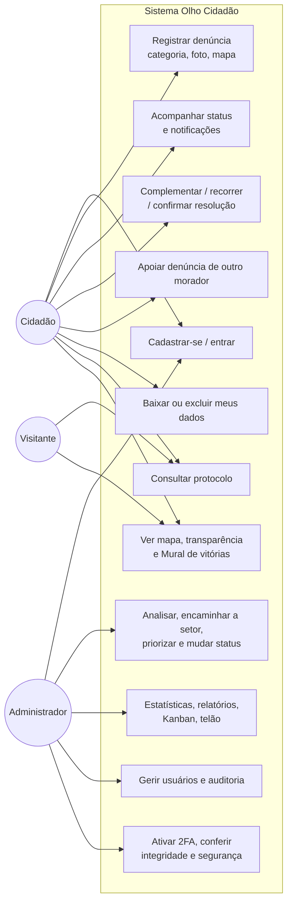
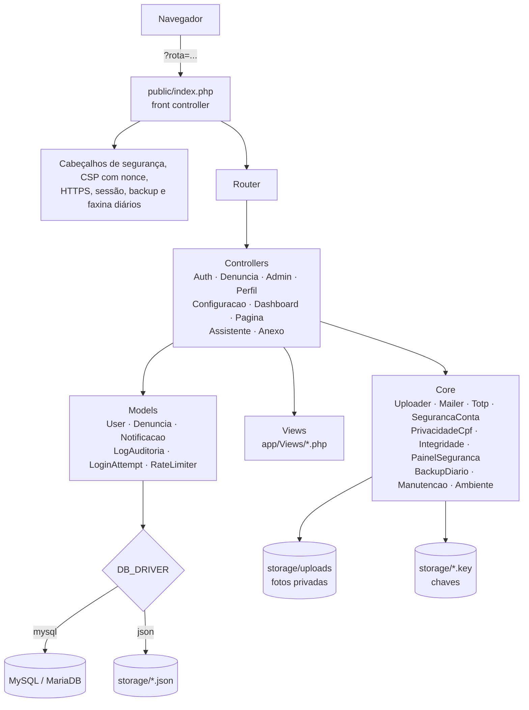
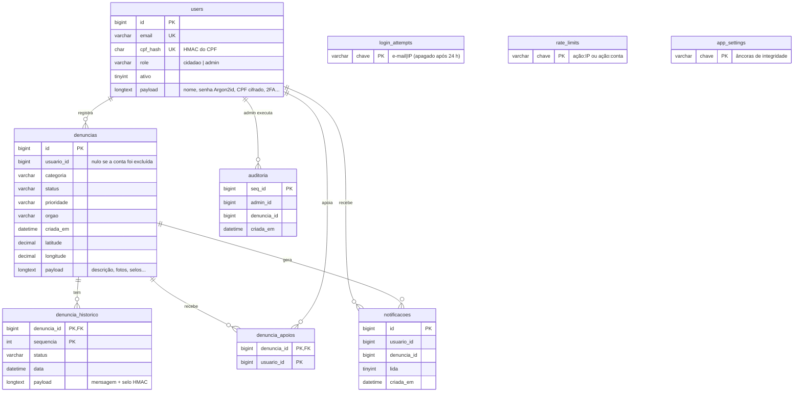
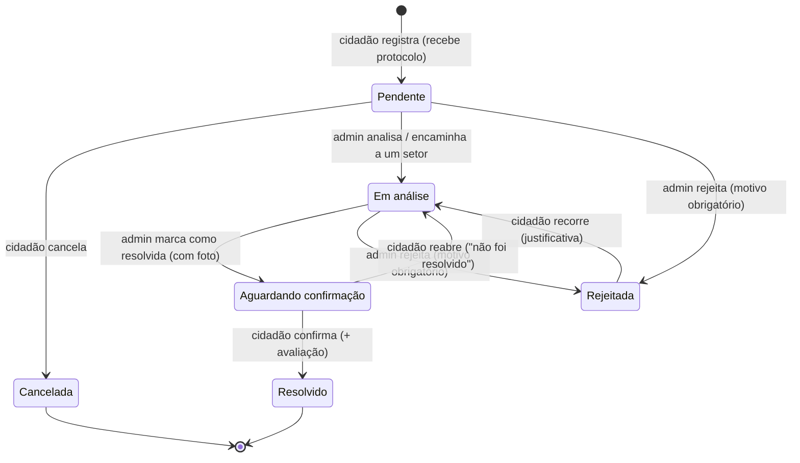
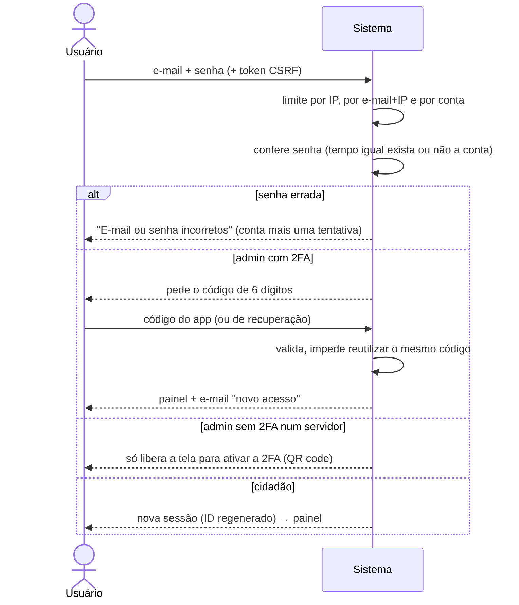

# Diagramas do Olho Cidadão (v1.0.3)

Os diagramas estão em **Mermaid**: o GitHub desenha sozinho, e dá para colar em https://mermaid.live para exportar como imagem para os slides.

## 1. Casos de uso

## 2. Arquitetura MVC

## 3. Banco de dados

## 4. Ciclo de vida da denúncia

Cada transição vira uma linha no histórico com um **selo HMAC encadeado** — se alguém alterar o banco por fora, a tela "Histórico íntegro" acusa.

## 5. Login com segurança

